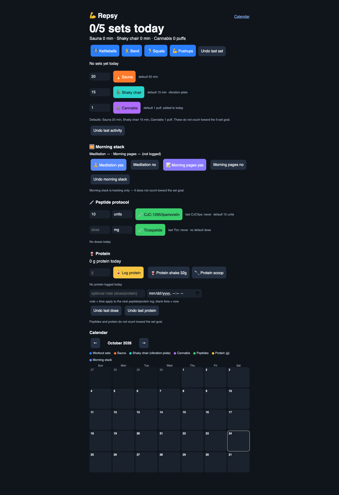
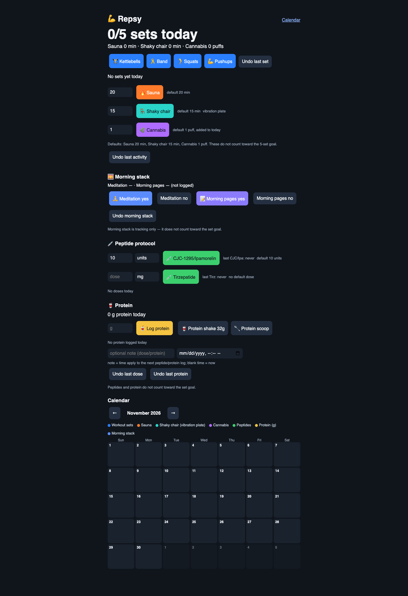

# Repsy

**A local-first macOS wellness tracker for simple daily habits.**

Repsy puts quick logging in the menu bar and shows progress in a private local
web dashboard. Track workouts, sauna time, meditation, morning pages, protein,
and other personal routines without an account or cloud service.





## Install on macOS

1. Clone or download this repository.
2. Open Terminal in the folder.
3. Run:

```bash
./install.sh
```

Repsy will start at login. Open the dashboard at
<http://127.0.0.1:8842/>.

The installer needs macOS and Python 3.12 or newer. It creates a local virtual
environment and installs the app's dependencies. No Search Atlas account, AI
service, or gateway is needed.

## Your data stays local

Repsy stores personal logs on the computer in `~/.repsy/` as JSON. The app binds
to `127.0.0.1`, so it is not exposed to the network by default. The repository
contains code and clean demo screenshots, not anyone's personal logs.

Export a profile for another Mac:

```bash
python transfer.py export ~/Desktop/repsy-profile.json
```

Import it on the other Mac after installing Repsy:

```bash
python transfer.py import ~/Desktop/repsy-profile.json
```

Repsy is a personal tracking tool, not medical advice.

## Remove it

```bash
launchctl bootout "gui/$(id -u)" "$HOME/Library/LaunchAgents/com.manick.repsy.plist"
rm -f "$HOME/Library/LaunchAgents/com.manick.repsy.plist"
```

## Development checks

```bash
ruff check .
pytest -q
```
